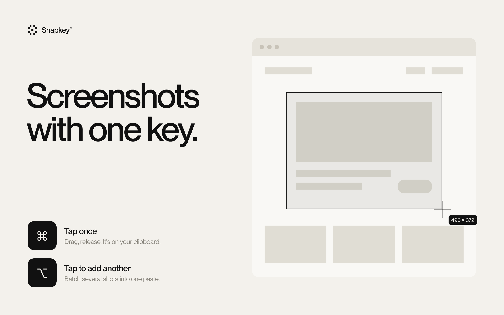
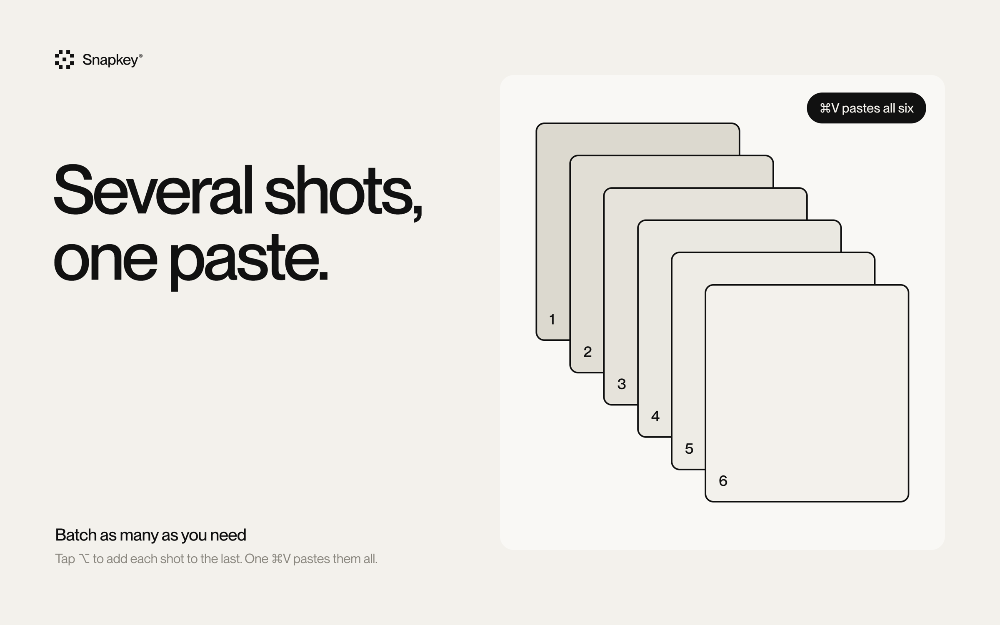
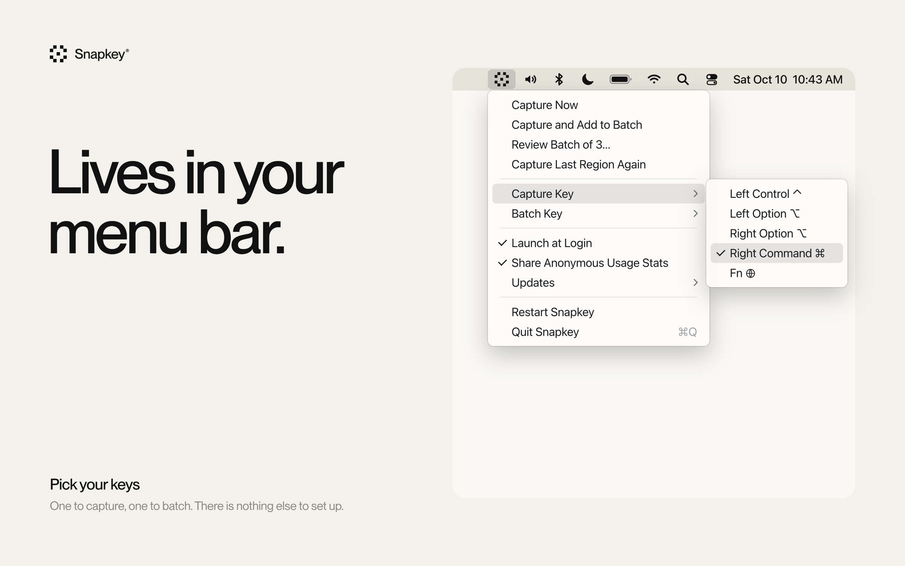
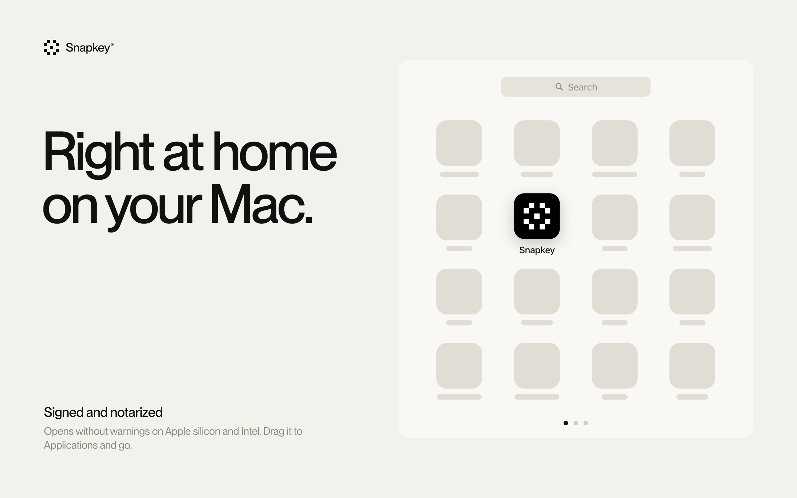

<h1 align="center">Snapkey®</h1>

<b>Screenshots with one finger.</b> 
Tap one key, drag, release. The shot is on your clipboard.

<a href="https://github.com/bravegabe/snapkey/releases/latest"><b>Download for Mac</b></a> 
macOS 13 or later · Apple silicon and Intel · signed and notarized

## Why

macOS can already copy a region of the screen to the clipboard, but the shortcut is a four-key chord (⌃⇧⌘4) that takes a whole hand and pulls you out of what you're doing.

Snapkey® turns it into a single tap of one modifier key, such as Right Command, the key sitting just above the trackpad. Your hand never leaves the trackpad.

## How it works

1. **Tap** your capture key on its own.
2. **Drag** over what you want and release.
3. **Paste** with ⌘V.

Press Esc to cancel a capture. **Double-tap** the key to capture the same area as last time, with no dragging, which is handy for a quick before and after. Normal shortcuts that use the same key (⌘C, ⌘V and so on) are ignored; only a quick solo tap triggers a capture.

## Batch several shots into one paste

Tap a second key (Right Option by default) and the next shot is **added** to the clipboard instead of replacing it. There's no limit: grab as many as you need, paste once, and they all land together.

While a batch is on your clipboard, the menu bar icon shows how many shots are in it.

To check a batch before you paste, choose **Review Batch** in the menu. You'll see every shot in paste order: remove one with its ×, or drag them into a new order. The clipboard updates as you go, so a bad shot doesn't mean starting over.

You can also type a label under any shot. A labeled shot pastes with a caption bar on top, like **3 · Checkout error state**, so Claude or anyone reading can tell your screens apart, even in a batch of 20. The bar sits above the screenshot, so nothing in it is covered, and shots without a label paste untouched.

Snapkey doesn't cap a batch, but the app you paste into may: some take every image, some cap how many they accept at once, and others take only the first.

## Lives in the menu bar

Everything is in one short menu:

- **Capture Now**, **Capture and Add to Batch** and **Capture Last Region Again**, for when you'd rather click than tap.
- **Review Batch**, to see, label, remove or reorder the shots in your batch.
- **Capture Key** and **Batch Key** submenus, where you pick the key for each. A checkmark shows the current one.
- **Launch at Login** and **Share Anonymous Usage Stats**, on or off.
- An **Updates** submenu with **Check Automatically**, **Check Now** and **What's New**.

There are no other windows or settings.

## Updates

Snapkey checks once a day for a new version and shows you what changed, with a button to download it. You can turn the check off under **Updates › Check Automatically** in the menu.

## Install

Snapkey is signed by Brave People, LLC and notarized by Apple, so it opens without security warnings.

1. Download the DMG from the [latest release](https://github.com/bravegabe/snapkey/releases/latest).
2. Open it and drag Snapkey to Applications.
3. Launch Snapkey. The welcome window walks you through the one permission it needs.

## Permission

Snapkey needs **Screen Recording** access, which macOS requires of any app that captures the screen. It only captures when you tap its key, and the image goes straight to your clipboard. Your screenshots never leave your Mac. Snapkey goes online for two things only:

- **Update check.** Once a day it asks GitHub for the latest version number.
- **Anonymous usage counts.** Once a day it reports how many captures, batch adds and re-shoots you made and how often you reviewed, trimmed, reordered or labeled a batch (never the labels themselves), along with the app version, the macOS version and a random install number. It never sends screenshots or anything about what is on your screen, and nothing identifies you. Turn it off with **Share Anonymous Usage Stats** in the menu.

---

Made by <a href="https://bravepeople.co">Brave People</a>, the team behind <a href="https://uxsignal.io">UX Signal</a>. © 2026 Brave People, LLC. The images above are illustrations.
